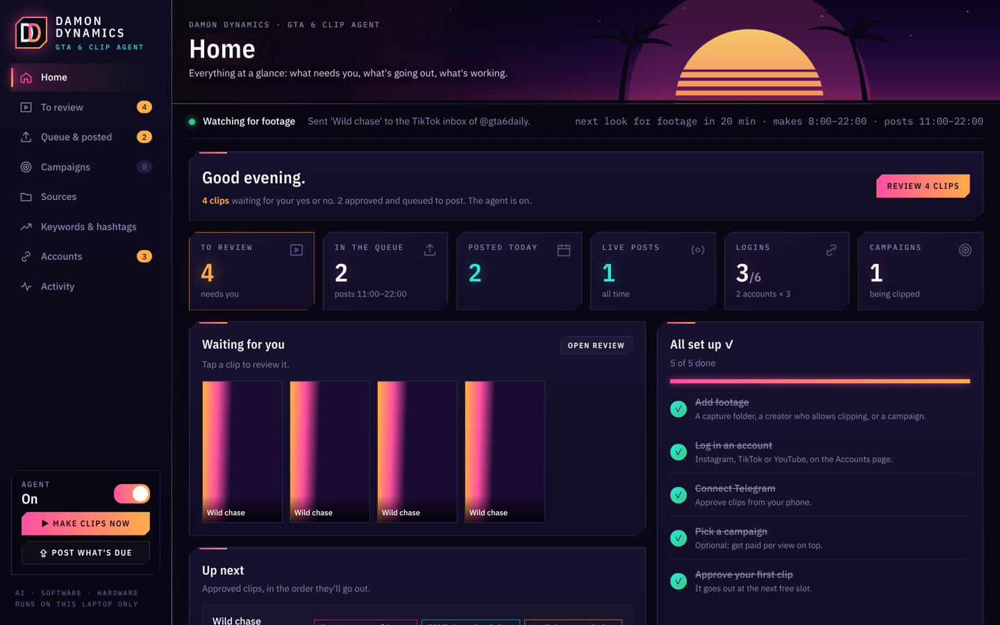
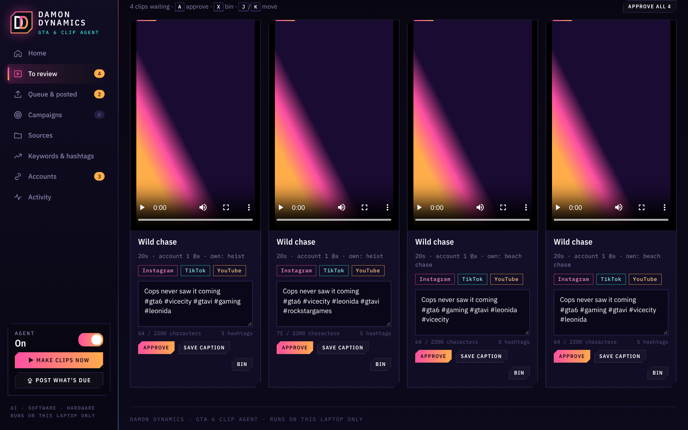
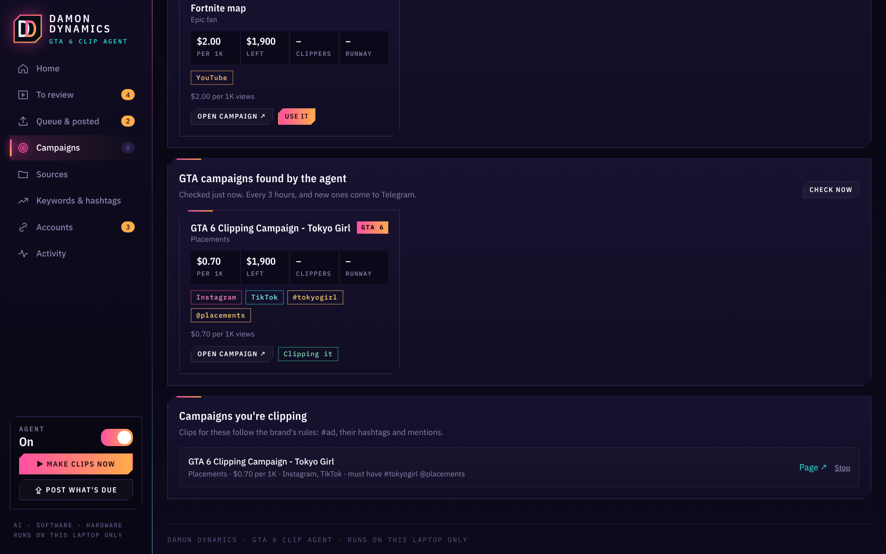
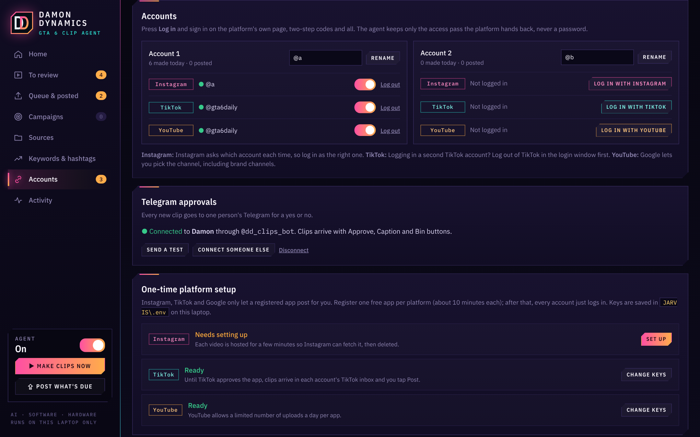

# GTA 6 Clip Agent

A desktop app that finds GTA 6 footage, cuts it into vertical clips with captions, asks you to approve each one, and posts the ones you approve to Instagram, TikTok and YouTube Shorts. It also finds paid clipping campaigns for you.

Made by **Damon Dynamics**. Runs on your own computer. Free to use.



## What it does

- **Finds footage.** It watches your own capture folders (your PS5 or PC recordings), YouTube channels whose creators allow clipping, and the footage that paid campaigns provide.
- **Cuts clips.** It transcribes the video, picks the strongest moments with AI, and renders 1080×1920 clips. Each clip gets word-by-word captions, a hook title and a face-tracked crop. Gameplay with no talking is cut on its shot changes.
- **Researches hashtags.** It reads what GTA 6 fans search for on YouTube and the hashtags on the top GTA 6 Shorts, and mixes the strongest into every caption.
- **Asks you first.** You approve, edit or bin each clip, in the app or with buttons in a Telegram chat. Nothing is posted without a yes.
- **Posts on a schedule.** It posts at most 4 a day per account on each platform, at least 45 minutes apart, between 11:00 and 22:00, and retries if a post fails.
- **Finds paid campaigns.** Every 3 hours it checks [Content Rewards](https://contentrewards.com) for GTA campaigns, and the search box finds campaigns for any keyword. Clips for a campaign follow its rules: `#ad` and the brand's required hashtags and mentions.

| Review | Campaigns | Accounts |
|---|---|---|
|  |  |  |

## Install

You need **Python 3.10 or newer** ([python.org](https://www.python.org/downloads/); on Windows, tick *Add python.exe to PATH*). An NVIDIA GPU makes transcription much faster (also run `pip install -r requirements-gpu.txt` inside `.venv`), but the CPU works too.

**Windows:** download this repo (*Code → Download ZIP*), unzip it, double-click `setup.bat`, then `start.bat`.

**macOS / Linux:** install ffmpeg (`brew install ffmpeg` or `sudo apt install ffmpeg`), then:

```bash
git clone https://github.com/damonchandio/gta6-clip-agent
cd gta6-clip-agent
bash setup.sh
bash start.sh
```

The app opens in its own window at `http://127.0.0.1:8771`. It only answers to this computer.

## First run

1. **Add footage.** On *Sources*, add your capture folder, or a YouTube channel whose creator allows clipping. Clips from a creator carry a credit line.
2. **Add a free AI key.** Get a [Groq key](https://console.groq.com/keys) and put it in `.env` as `GROQ_API_KEY`. Without it, clips are cut on shot changes and get hashtags only. [Ollama](https://ollama.com) running locally works too.
3. **Log in your accounts.** On *Accounts*, press **Log in with Instagram / TikTok / YouTube**. Each platform needs a free app registered once (about 10 minutes each). The app walks you through it and saves the keys for you.
4. **Optional: Telegram.** Make a bot with [@BotFather](https://t.me/BotFather), paste its token on *Accounts*, then press *Connect Telegram* and open the link on your phone.
5. Press **Make clips now**, or leave it on. It looks for new footage every 20 minutes, from 08:00 to 22:00.

## Connecting the platforms

Every account logs in on the platform's own page. The app never sees or stores a password, only the access token the platform hands back.

| Platform | What to register | Good to know |
|---|---|---|
| Instagram | A Meta app with *Instagram API with Instagram Login*. Add each account as an Instagram Tester. | Accounts must be Professional (Creator or Business). Instagram downloads each video from a link, so you also need a free [Supabase](https://supabase.com) project with a **public** storage bucket named `reels`. Put its `SUPABASE_URL` and `SUPABASE_KEY` (service role) in `.env`. Each video is deleted from the bucket right after posting. |
| TikTok | An app on [TikTok for Developers](https://developers.tiktok.com) with Login Kit (Desktop) and the Content Posting API. | Until TikTok approves your app, clips go to the account's **TikTok inbox** and you tap Post in the app. After approval, set `TIKTOK_AUDITED=1` and they post publicly on their own. |
| YouTube | A Google Cloud OAuth client of type **Desktop app**, with YouTube Data API v3 turned on. | Publish the consent screen (*In production*), otherwise Google logs the channels out every 7 days. YouTube limits API uploads per day. |

All settings are listed in [`.env.example`](.env.example).

## Use it fairly

- Only clip footage you have the right to use: your own captures, creators who allow clipping, and the footage campaigns provide. The app clips a channel only after you tick *this creator allows clipping*.
- Join campaigns yourself on Content Rewards and follow their terms. The app adds `#ad` to campaign clips; keep it.
- Follow each platform's rules for automated posting. You own your accounts and what is posted on them.

Not affiliated with, endorsed by or connected to Rockstar Games or Take-Two Interactive. *Grand Theft Auto* and *GTA* are their trademarks.

## Tests

```bash
.venv/bin/python -m pytest -q          # Windows: .venv\Scripts\python -m pytest -q
python -m gta6 --selftest              # the agent's logic against fake services (no network, nothing posted)
```

The tests cover:
- finding footage, research, campaigns and clip-making;
- logging in to TikTok and YouTube;
- posting to all three platforms, with retries, spacing and daily caps;
- Telegram approvals and saving keys;
- the window's security checks;
- the AI falling back from one model to the next;
- a real offline render of a 1080×1920 clip.

## Troubleshooting

- **"Sign in to confirm you're not a bot" from YouTube:** YouTube sometimes blocks downloads. Use your own captures, or try again later.
- **Transcription fails with `metadata_errors`:** run setup again. It installs the PyAV version faster-whisper needs.
- **"GPU transcription failed; trying the CPU":** that's normal without an NVIDIA GPU and CUDA. Set `WHISPER_DEVICE=cpu` to skip the attempt.
- The app's own log is `data/gta6/agent.log`.

## How it's built

`gta6/` is the agent and its window: plain Python with no web framework, and one HTML page. `clipper/` is the clip engine: yt-dlp, faster-whisper, OpenCV and ffmpeg. Everything it saves lives in `data/` on your computer.

## Licence

MIT. See [LICENSE](LICENSE). The IBM Plex fonts in `assets/fonts` are under the SIL Open Font License (see `assets/fonts/OFL.txt`).
